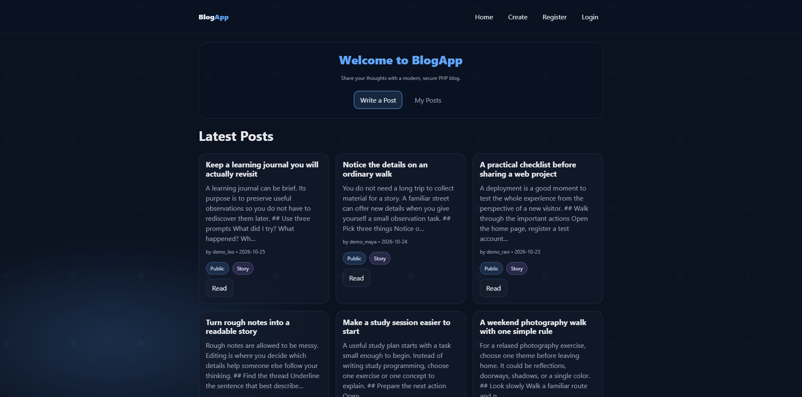
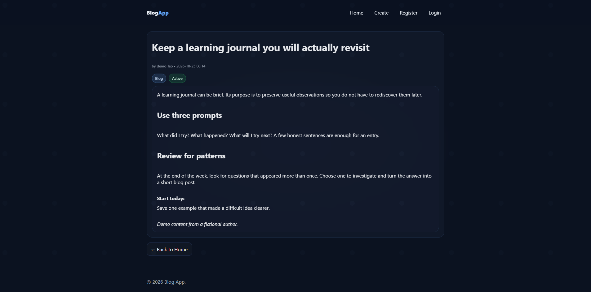
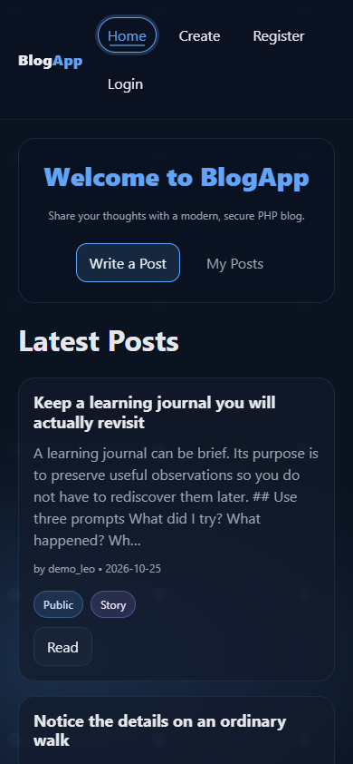
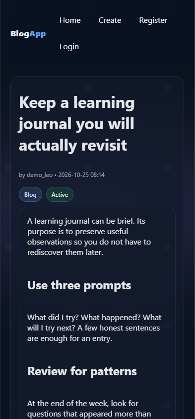

# BlogApp

A responsive blog application built with PHP and MySQL. Users can create an account, publish stories, and manage their own posts through a simple writing interface.

**[View live website](https://blog-web-ecru-delta.vercel.app/)**

## Features

- Register and log in with a username or email.
- Create, read, edit, and delete blog posts.
- Manage personal content through **My Posts**.
- Preview lightweight Markdown formatting while writing.
- Browse a responsive interface on desktop and mobile.
- Stay signed in with database-backed sessions on Vercel.

## Screenshots

### Desktop

| Home page | Post page |
| --- | --- |
|  |  |

### Mobile

<p>
  
  
</p>

## Tech stack

| Layer | Technology |
| --- | --- |
| Backend | PHP 8 and PDO |
| Database | MySQL hosted on Aiven |
| Frontend | HTML, CSS, and vanilla JavaScript |
| Hosting | Vercel with the community PHP runtime |

## Security

- Password hashing and verification with PHP.
- Prepared SQL statements and escaped page output.
- CSRF protection for authentication and post actions.
- Ownership checks for editing and deleting posts.
- Secure, HTTP-only session cookies on Vercel.
- Verified TLS connections to Aiven MySQL.
- Database credentials supplied through environment variables on Vercel.

## Project structure

```text
api/           Vercel entry point and PHP runtime settings
assets/        CSS and browser scripts
config/        Database connection and configuration example
includes/      Shared templates, helpers, and session storage
public/        Blog pages and post actions
screenshots/   Desktop and mobile images for this README
index.php      Local redirect to the blog
vercel.json    Vercel deployment configuration
```

## Author

**Dineth Dovindu** — [GitHub](https://github.com/kdinethdovindu)
